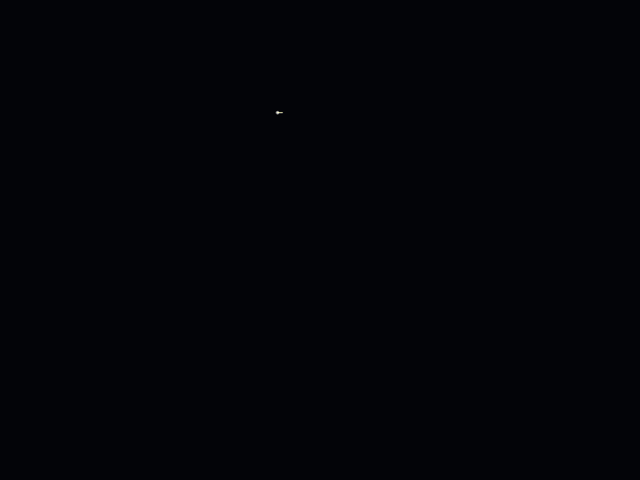
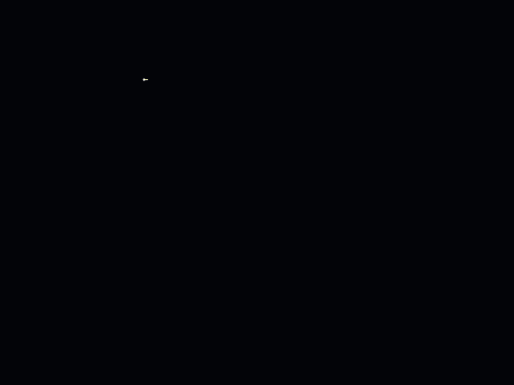
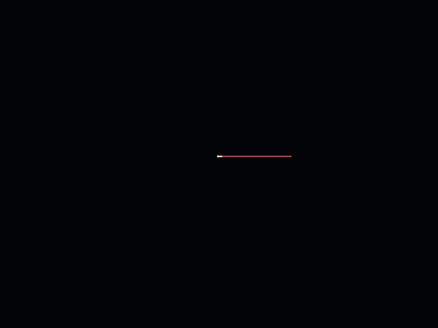

# fractal

进制 $b$ ，方向数 $\text{dir}$ 

绘制分形，实时调参/缩放的交互窗口.

- 龙形曲线 (twindragon)

    `--base 2 --dir 4 --rule linear --steps 32768 --story draw --fps 12 --secs 4`



- 科赫弧 (默认参数) 
 
`--base 4 --dir 6 --rule fold --steps 65536 --story draw --fps 15 --secs 5`


- 密集填充

`--base 3 --dir 7 --rule linear --steps 177147 --story draw --fps 15 --secs 5`

- 深渲染 (步数 $2^{50}$) :
    
     `--base 2 --dir 4 --rule linear --steps 2^50 --story grow --fps 15 --secs 5`

- 亮色主题 (`--bg light`)

    
    `--base 2 --dir 4 --rule linear --steps 32768 --bg light --story draw --fps 12 --secs 4`

- 高进制密集填充

`--base 5 --dir 8 --rule linear --steps 390625 --story draw --fps 15 --secs 5 --width 720 --height 540`

- 交替规则 ($|S| = 0.618 < 1$, 收缩型)

`--base 3 --dir 5 --rule alternate --steps 59049 --story draw --fps 15 --secs 5 --width 720 --height 540 --ss 1`

- 稀疏骨架 ($\text{dir} \le b$)

`--base 6 --dir 4 --rule linear --steps 200000 --story grow --fps 15 --secs 5 --width 720 --height 540`

- 镜像 ($\text{dir}$ 取负号, 与上面的 $(3,7)$ 成对)

`--base 3 --dir -7 --rule linear --steps 177147 --story grow --fps 15 --secs 5 --width 720 --height 540`

- 巡游缩放 (`--story tour`: 画完推进放大看自相似层级)

`--base 3 --dir 7 --rule linear --steps 177147 --story tour --bg light --fps 15 --secs 6 --width 720 --height 540`

上面所有示例图的输出都是 720x540 (默认是 1600x1200).


## 数学原理

$$\theta_n = \frac{2\pi}{\text{dir}}\sum_i g(r_i), \qquad z_{n+1} = z_n + e^{i\theta_n}$$

其中 $r_i$ 是 $n$ 的 $b$ 进制各位数字, $g$ 是**逐位转角表** (由 `--rule` 选择):

| `--rule` | $g(r)$ | 说明 |
|---|---|---|
| `linear` (默认) | $r$ | 数字和, 即 $\theta_n = \frac{2\pi}{\text{dir}}s_b(n)$ |
| `alternate` | $(-1)^r r$ | 符号随数字值交替 |
| `fold` | $(-1)^r\min(r,\,b-1-r)$ | 先折到半程再交替符号; $(b,\text{dir})=(4,6)$ **正好给出科赫弧** |

三个表都满足 $g$ 的逐位可加性 $f(bm+r)=f(m)+g(r)$, 所以下面所有结论 (块恒等式, 自相似比, 深渲染, 分级揭示, 缩放) 对三种规则同时成立.

两个边界情况: `fold` 在 $b=2$ 时权重全为 0 (退化成直线, `DigitRule::is_degenerate_for` 会标出来); `alternate` 会出现 $\lvert S\rvert<1$ 的收缩规则 (例如 $(3,5)$, $\lvert S\rvert=0.618$), 同样有界但不是周期图形.

- $s_b(n)$: $n$ 的 $b$ 进制各位数字之和.
- $\text{dir}$ 是**圆周等分数**: 每 1 点数字和让海龟转 $360^\circ/\text{dir}$ 度. $\text{dir}=4$ 就是 90 度/点, $\text{dir}=6$ 是 60 度/点.
- 朝向是绝对的 (只由 $n$ 决定, 不累加), 每步长度恒为 1; $\text{dir}$ 取负号是镜像.

记 $f(n)=\sum_i g(r_i)$, $\zeta = e^{2\pi i/\text{dir}}$, 则第 $n$ 步的增量是 $\zeta^{f(n)}$ ($\text{linear}$ 时就是 $\zeta^{s_b(n)}$). 由 $f(bm+r)=f(m)+g(r)$ 得到**块恒等式**:

$$z(m\,b^L + j) = S^L z(m) + \zeta^{f(m)} z(j), \qquad 0 \le j < b^L, \qquad S = \sum_{r=0}^{b-1}\zeta^{\,g(r)} = \frac{1-\zeta^{\,g(b)\,b}}{1-\zeta^{\,g(1)}}\ \ (\text{linear})$$

它就是整个工具的基础: 自相似, 分级揭示, 深渲染都由此而来. 判据是 $|S|$ (对三种规则都能直接算). 对 $\text{linear}$ 才有简化式 $|S| = \left|\sin(\pi b/\text{dir})\right| / \left|\sin(\pi/\text{dir})\right|$, 于是记 $r = b \bmod |\text{dir}|$:

| 条件 | 结果 |
|---|---|
| $r = 0$ (linear) | $S = 0$: 每 $b^k$ 步回到原点, 有界闭合折线, 顶点数 $\le b\cdot|\text{dir}|+1$, 只适合看规则图形 |
| $r = \pm 1$ (linear) | $\lvert S\rvert = 1$: $S$ 是纯旋转, 有界周期, 不是分形 |
| 其他 | $\lvert S\rvert > 1$: 扩张自相似分形 |

科赫弧的例子: `--base 4 --dir 6 --rule fold` 的自相似比正好 $|S| = 1+\zeta^{-1}+\zeta^{+1}+1 = 3$, 与科赫曲线"每级 4 份, 尺度比 3"一致; 渲染后实测盒计数维数 $D=1.31$ (科赫理论值 $\log 4/\log 3 = 1.262$). 注意 `linear` 族里没有科赫: 那要求同时满足 (4 份, 比值 3, 60 度), 而 $|S|=\sin(\pi b/\text{dir})/\sin(\pi/\text{dir})$ 与转角由同一个 $\text{dir}$ 钉死, 无整数解.

经验规律:

- $\text{dir} > b$ 且 $r \notin \{0,\pm1\}$: 面积填充型密集分形. 例如 $(2,4)$ $(2,5)$ $(2,8)$ $(2,12)$ $(3,7)$ $(4,9)$ $(5,8)$ $(6,11)$ $(9,11)$.
- $\text{dir} \le b$: 仍会扩张但坍缩成稀疏骨架 (如 $(6,4)$ $(10,4)$ $(10,7)$), 适合看结构不适合看细节.
- $\text{dir} = 1$ (或 $-1$): 每步转满一圈, 退化成直线射线.

$(b,\text{dir}) = (2,4)$ 时 $S = 1+i$, 即 twindragon 数系 (复基 $1+i$, 数字 $\{0,1\}$) 的自相似比例, 属龙形曲线族.

## 运行

```bash
cargo run --release                                   # 打开交互窗口GUI (默认 b=4 dir=6 rule=fold n=65536)
cargo run --release -- render --base 3 --dir 6 --steps 177147 --out out/hex60
cargo run --release -- render --base 2 --dir 4 --steps 1125899906842624 --zoom 1e4 --out out/deep
cargo run --release -- anim   --base 2 --dir 5 --steps 200000 --story grow --secs 6 --out out/pentagon
cargo run --release -- anim   --base 3 --dir 3 --steps 59049 --gif --secs 5 --out out/closed
cargo run --release -- --help
cargo test                                            # 65 个测试
```

`render` 输出 PNG (小步数另有 SVG); `anim` 默认把 RGB 帧直接管道给 `ffmpeg` 生成 H.264 MP4 (无中间帧落盘), 没有 `ffmpeg` 时用 `--gif` (内置零依赖 GIF89a 编码器) 或 `--frames-dir` 输出 PNG 序列.

### 全部参数

`适用` 一列标明参数对哪个子命令生效 (`全部` = gui / render / anim).

| 参数 | 含义 | 适用 | 默认 |
|---|---|---|---|
| `--base B` | 进制 2..64 | 全部 | 2 |
| `--dir D` | 圆周等分数 $\lvert D\rvert$ 1..64, 负号=镜像 | 全部 | 4 |
| `--rule R` | 逐位转角表 `linear` / `alternate` / `fold` | 全部 | linear |
| `--steps N` | 步数 1..$2^{50}$, 支持 `2^30` / `1.5e6` / `2_000_000` | 全部 | 65536 |
| `--bg T` | 主题 `dark` / `light` | 全部 | dark |
| `--lang L` | 界面语言 `en` / `zh` | gui | en |
| `--width W` `--height H` | 输出尺寸 (render / anim) 或窗口尺寸 (gui) | 全部 | render/anim 1600x1200, gui 1500x900 |
| `--ss S` | 超采样 1..4 | render/anim | 2 |
| `--hue H` `--gain G` | 色相偏移 0..1, 描边浓度 (0,10] | 全部 | 0, 1 |
| `--zoom Z` `--center X,Y` | 放大倍数与视口中心 (世界坐标) | render | 1, 图形中心 |
| `--out PATH` | 输出路径前缀 (自动去扩展名) | 全部 | `out/curve_b{B}_d{D}_n{N}` |
| `--story S` `--fps F` `--secs T` | 故事 `draw` / `grow` / `tour`, 帧率, 时长 | anim | draw, 30, 8 |
| `--gif` | 输出 GIF 而不是 MP4 | anim | 关 |
| `--frames-dir D` | 输出 PNG 帧序列到目录 D | anim | 关 |
| `--no-svg` | 不写 SVG | render | 关 |
| `--quiet` | 关闭进度输出 | 全部 | 关 |
| `--frames N` | 渲染 N 帧后自动退出 (冒烟测试) | gui | 关 |
| `--shot P` | 退出前把整个窗口截图为 P | gui | 关 |

